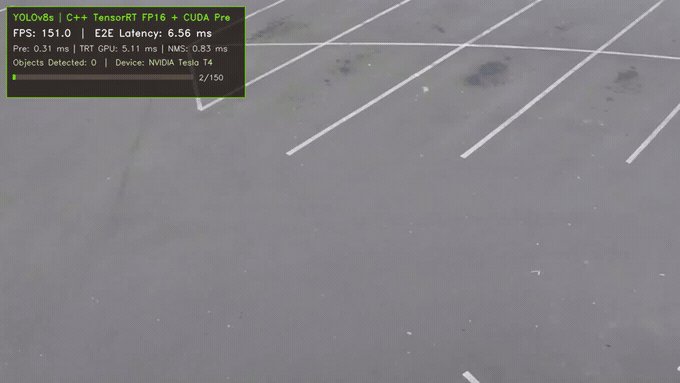
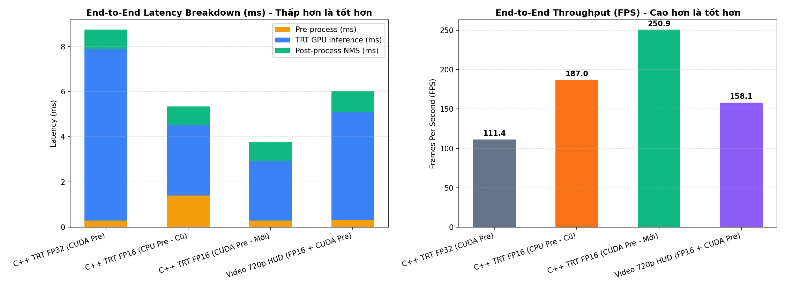
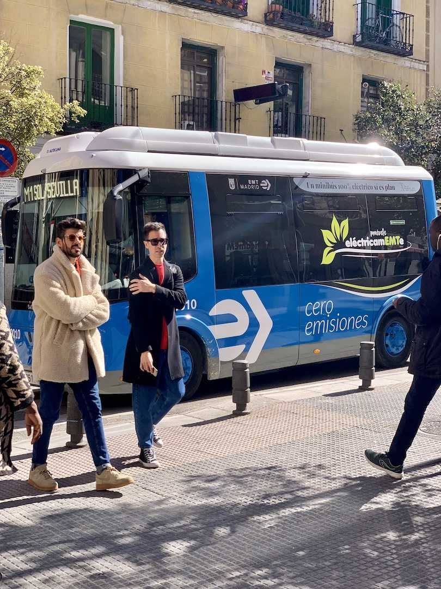
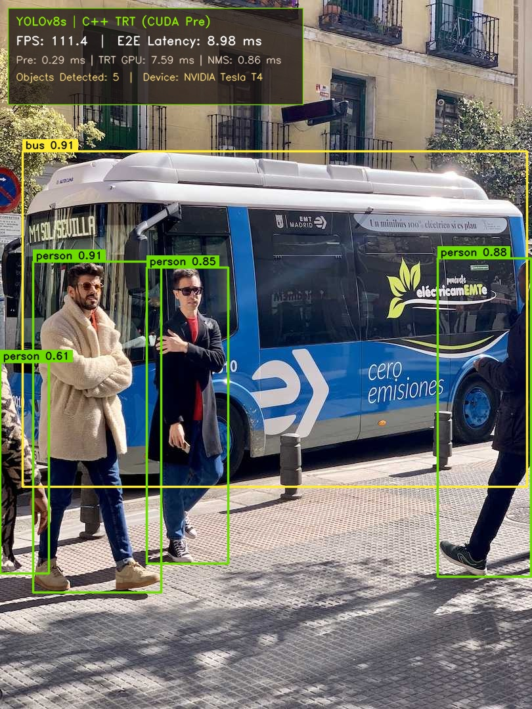

# Tăng tốc suy luận YOLO trên Edge bằng TensorRT

Dự án triển khai pipeline suy luận YOLOv8s bằng TensorRT, C++17, CUDA và OpenCV. Chương trình C++ sử dụng bộ đệm pinned trên host, CUDA stream không chặn, tiền xử lý GPU kết hợp letterbox/chuyển đổi màu/chuẩn hóa, TensorRT inference, NMS trên CPU, benchmark ảnh và xuất video có khung nhận diện.

> Các file JSON benchmark trong repo là số đo trên môi trường Tesla T4/Kaggle. Engine phụ thuộc nền tảng và phiên bản TensorRT; hãy build lại trên máy đích. Repo không chứa dataset hoặc trọng số mô hình.

## Demo

Các hình bên dưới được tạo từ binary C++ build từ `src/`, dùng engine YOLOv8s TensorRT FP16 và CUDA preprocessing trên Tesla T4.

### Suy luận video

GIF minh họa bounding box, confidence, FPS và latency theo frame. [Mở video MP4 đầy đủ](assets/demo_yolov8_trt_cpp.mp4).



### Kết quả nhận diện trên ảnh


### So sánh hiệu năng

Biểu đồ tổng hợp các artifact benchmark đang có trong repo. Các lượt đo khác nhau về workload nên chỉ dùng để tham khảo; chi tiết nằm trong bảng kết quả bên dưới.



### Tái tạo demo từ mã nguồn

Sau khi build `yolo_infer` và có engine `models/engines/yolov8s_fp16.engine`, có thể tạo lại ảnh HUD và video bằng chính pipeline C++ trong `src/`. Các lệnh dưới đây cần `curl` và FFmpeg; chúng ghi đè các demo tương ứng trong `assets/`.

```bash
mkdir -p assets benchmarks
curl -fL https://ultralytics.com/images/bus.jpg -o /tmp/yolov8s_demo.jpg
./build/yolo_infer models/engines/yolov8s_fp16.engine /tmp/yolov8s_demo.jpg assets/detection_hud_sample.jpg 500 benchmarks/cpp_fp16_cuda_pre.json

curl -fL https://github.com/intel-iot-devkit/sample-videos/raw/master/person-bicycle-car-detection.mp4 -o /tmp/traffic_source.mp4
ffmpeg -nostdin -y -i /tmp/traffic_source.mp4 -t 5 -vf "scale=1280:720:flags=lanczos,fps=30" -c:v libx264 -pix_fmt yuv420p /tmp/traffic_720p.mp4
./build/yolo_infer --video models/engines/yolov8s_fp16.engine /tmp/traffic_720p.mp4 assets/demo_yolov8_trt_cpp.mp4 benchmarks/cpp_video_720p_cuda_pre.json
ffmpeg -nostdin -y -i assets/demo_yolov8_trt_cpp.mp4 -vf "fps=12,scale=680:-1:flags=lanczos,split[s0][s1];[s0]palettegen=max_colors=128:stats_mode=diff[p];[s1][p]paletteuse=dither=bayer:bayer_scale=3" -loop 0 assets/demo_yolov8_trt_cpp.gif
```

Ảnh, MP4/GIF và JSON sẽ được tạo bằng engine C++ native. FPS/latency thực tế thay đổi theo GPU, phiên bản TensorRT và tải hệ thống; số hiện trên HUD được đo khi chạy, không phải giá trị cố định.

## Yêu cầu

- Ubuntu/Linux x86_64, GPU NVIDIA, CUDA Toolkit, cuDNN, TensorRT và các gói phát triển OpenCV. Cấu hình CMake hiện nhắm compute capability 7.5 (Tesla T4) và sử dụng đường dẫn thư viện TensorRT trên Linux.
- CMake 3.18 trở lên, trình biên dịch C++17 và trình biên dịch CUDA.
- Python cùng PyTorch, Ultralytics, OpenCV, NumPy và gói TensorRT Python tương thích để export, calibration, benchmark và đánh giá mAP.
- `curl` và FFmpeg nếu muốn tải video mẫu và tạo lại GIF demo.

Cài các gói Python trong môi trường tương thích với CUDA/TensorRT đang dùng. Nên cài TensorRT từ bộ phân phối NVIDIA khớp với runtime native; lệnh `pip install tensorrt` thông thường có thể không tương thích với thư viện hệ thống.

## Dữ liệu

- COCO 2017: [Dataset trên Kaggle](https://www.kaggle.com/datasets/awsaf49/coco-2017-dataset/data). Đặt ảnh calibration trong `data/calibration/`; đặt ảnh và annotation validation theo cấu trúc mà file YAML COCO của Ultralytics yêu cầu. Dùng tập đại diện khoảng 100-500 ảnh để calibration INT8.
- VisDrone: [Dataset trên Kaggle](https://www.kaggle.com/datasets/banuprasadb/visdrone-dataset/data). Model và bộ parse output hiện dành riêng cho COCO (80 lớp, `[1, 84, 8400]`), nên chưa thể đánh giá VisDrone trực tiếp. Cần model được train/export theo bộ lớp VisDrone, cùng parser và dataset YAML tương ứng.

Git bỏ qua file dataset và model. COCO128 phù hợp để chạy thử nhanh; khi báo cáo mAP, hãy dùng COCO val2017 cùng annotation.

## Export model và build engine

Chạy từ thư mục gốc repo:

```bash
python scripts/export_onnx.py --weights yolov8s.pt
```

Script export tạo `models/yolov8s.pt`, `models/yolov8s.onnx` và `models/yolov8s_fp16.onnx`. Build TensorRT plan FP32 và FP16 bằng phiên bản TensorRT được cài trên máy triển khai:

```bash
mkdir -p models/engines
trtexec --onnx=models/yolov8s.onnx --saveEngine=models/engines/yolov8s_fp32.engine --memPoolSize=workspace:4096
trtexec --onnx=models/yolov8s.onnx --saveEngine=models/engines/yolov8s_fp16.engine --fp16 --memPoolSize=workspace:4096
```

Để build INT8, trước tiên thêm ảnh vào `data/calibration/`. Nếu thiếu ảnh calibration hoặc TensorRT không hỗ trợ INT8, script sẽ báo lỗi thay vì âm thầm ghi ra engine không phải INT8:

```bash
python scripts/calibrate_int8.py --onnx models/yolov8s.onnx --calibration-dir data/calibration --output models/engines/yolov8s_int8.engine --max-images 500
```

Calibration sử dụng entropy calibrator của TensorRT và lưu cache cạnh engine. Cache phụ thuộc model, tập calibration và môi trường TensorRT/GPU.

## Build chương trình C++

```bash
cmake -S . -B build -DCMAKE_BUILD_TYPE=Release
cmake --build build --parallel
```

Build hiện giả định CUDA compute capability 7.5 và đường dẫn TensorRT tiêu chuẩn trên Linux. Nếu dùng GPU hoặc cách cài đặt khác, hãy điều chỉnh `CMAKE_CUDA_ARCHITECTURES` và đường dẫn include/library của TensorRT trong `CMakeLists.txt`. Engine TensorRT không dùng được một cách phổ quát trên mọi kiến trúc GPU hoặc phiên bản TensorRT.

## Chạy chương trình

Suy luận ảnh với tiền xử lý CUDA kết hợp (warm-up 100 vòng, sau đó đo 2.000 vòng):

```bash
./build/yolo_infer models/engines/yolov8s_fp16.engine data/val2017/IMAGE.jpg output.jpg 2000 benchmarks/native_fp16.json
```

So sánh tiền xử lý CPU với tiền xử lý CUDA:

```bash
./build/yolo_infer --cpu-pre models/engines/yolov8s_fp16.engine data/val2017/IMAGE.jpg output_cpu_pre.jpg 2000 benchmarks/native_fp16_cpu_pre.json
```

Tạo video có khung nhận diện và file JSON benchmark theo từng frame:

```bash
./build/yolo_infer --video models/engines/yolov8s_fp16.engine input.mp4 output_hud.mp4 benchmarks/video.json
```

Benchmark end-to-end bằng Python (dùng ảnh đầu tiên trong `data/val2017/`; nếu không có ảnh, script dùng frame tổng hợp có thể tái lập):

```bash
python scripts/benchmark_python.py --weights models/yolov8s.pt --warmup 100 --iterations 2000 --output benchmarks/pytorch_baseline.json
```

Để so sánh công bằng, hãy dùng cùng ảnh thật và độ phân giải đầu vào cho mọi cách triển khai. Latency của `predict` trong Python bao gồm tiền xử lý và hậu xử lý của Ultralytics. Số đo C++ native bao gồm tiền xử lý, đồng bộ truyền dữ liệu/suy luận và NMS; metric của công đoạn TensorRT cũng tính cả truyền output về host. Không nên xem các số đo có phạm vi thời gian khác nhau là latency thuần của model.

Đo mAP50 và mAP50-95 bằng dataset YAML với model `.pt` hoặc TensorRT engine tương thích:

```bash
python scripts/evaluate_map.py --model models/yolov8s.pt --data path/to/coco.yaml --imgsz 640 --batch 1
python scripts/evaluate_map.py --model models/engines/yolov8s_fp16.engine --data path/to/coco.yaml --imgsz 640 --batch 1
```

Script ghi kết quả vào `benchmarks/map_<model>.json`. Khi so sánh model và engine, hãy dùng cùng tập validation, kích thước ảnh, ngưỡng confidence/NMS và phiên bản Ultralytics. Cách này đánh giá TensorRT engine thông qua Ultralytics, không phải bộ hậu xử lý C++ native.

## Kết quả benchmark hiện có

Đây là các giá trị đang có trong artifact benchmark của repo. Chúng chưa phải phép so sánh trực tiếp có kiểm soát vì ảnh đầu vào, phạm vi đo thời gian và số vòng lặp khác nhau. Hãy chạy lại hai pipeline với cùng ảnh và quy trình trước khi dùng làm tuyên bố hiệu năng.

### Output test mới

Hai output dưới đây được tạo từ cùng cảnh xe buýt/người trong [video test đầu vào](test_result/traffic_input_150f.mp4). Kết quả CPU-pre chạy TensorRT FP16 trong 500 vòng; kết quả CUDA-pre chạy TensorRT FP32 trong 300 vòng.

<table>
	<thead>
		<tr>
			<th>Ảnh đầu vào</th>
			<th>TensorRT FP16, CPU preprocessing</th>
			<th>TensorRT FP32, fused CUDA preprocessing</th>
		</tr>
	</thead>
	<tbody>
		<tr>
			<td></td>
			<td></td>
			<td></td>
		</tr>
	</tbody>
</table>

| Pipeline | Precision | Vòng đo | Phát hiện | Preprocess (ms) | TensorRT + truyền output (ms) | NMS (ms) | E2E trung bình (ms) | E2E p50 / p95 / p99 (ms) | FPS |
| --- | --- | ---: | ---: | ---: | ---: | ---: | ---: | --- | ---: |
| CPU preprocessing | FP16 | 500 | 5 | 1.3934 | 3.1323 | 0.8210 | 5.3467 | 5.2625 / 5.7049 / 7.5001 | 187.03 |
| Fused CUDA preprocessing | FP32 | 300 | 5 | 0.2877 | 7.5910 | 0.8645 | 8.9806 | 8.9341 / 9.2950 / 9.9929 | 111.35 |

HUD trong ảnh test phản ánh các giá trị trên. Đây không phải phép đo A/B chỉ riêng preprocessing: precision và số vòng lặp cũng khác nhau. Để kết luận tác động của CPU/CUDA preprocessing, hãy chạy cùng engine, cùng frame và cùng số vòng đo ở cả hai chế độ.

| Cách triển khai | Độ chính xác | mAP50 / mAP50-95 | Latency p50 / p95 (ms) | FPS | VRAM |
| --- | --- | --- | --- | ---: | --- |
| PyTorch Python | FP32 | Chưa đo | 12.17 / 12.55 | 82.03 | 119.38 MB peak allocator PyTorch* |
| TensorRT C++ native, tiền xử lý CUDA | FP32 | Chưa đo | 8.934 / 9.295 E2E | 111.35 | Chưa ghi nhận |
| TensorRT C++ native, tiền xử lý CUDA | FP16 | Chưa đo | 3.976 / 4.128 E2E | 250.87 | Chưa ghi nhận |
| TensorRT C++ native, tiền xử lý CPU | FP16 | Chưa đo | 5.263 / 5.705 E2E | 187.03 | Chưa ghi nhận |
| TensorRT C++ native, tiền xử lý CUDA, video 720p | FP16 | Chưa đo | 6.226 / 6.981 E2E | 158.10 | Chưa ghi nhận |

*Giá trị PyTorch là peak memory của allocator trong baseline đã lưu, không phải tổng VRAM của tiến trình/GPU; vì vậy không thể so sánh trực tiếp với số đo NVML hoặc `nvidia-smi`. Repo hiện chưa có số đo mAP hay VRAM của C++ native. Không suy ra mức giảm mAP từ precision hoặc latency.

## Ghi chú kiến trúc

Bộ nhớ ảnh/input/output trên host được cấp phát bằng `cudaMallocHost` (pinned memory). Pinned memory cho phép DMA truyền bất đồng bộ; đây vẫn là RAM trên host, không phải VRAM. Buffer cấp phát bằng `cudaMalloc` lưu tensor trong bộ nhớ thiết bị. Một CUDA stream không chặn sắp thứ tự các bước copy ảnh thô H2D, tiền xử lý kết hợp, TensorRT enqueue và copy output D2H. Pipeline hiện đồng bộ trước khi chạy NMS trên CPU, nên các bước bất đồng bộ trong cùng stream nhưng chưa chồng lấp xử lý nhiều frame.

Parser native và kích thước buffer giả định output YOLOv8s COCO tĩnh ở 640x640, gồm 80 lớp và 8.400 ứng viên. `configs/config.yaml` ghi lại các thiết lập tham chiếu này; runner C++ hiện biên dịch sẵn các kích thước và ngưỡng tương ứng làm giá trị mặc định.
